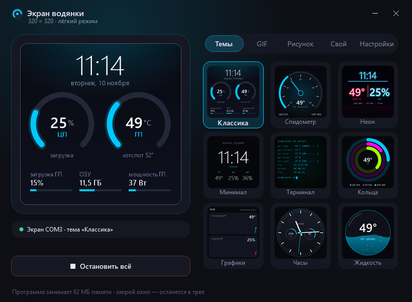
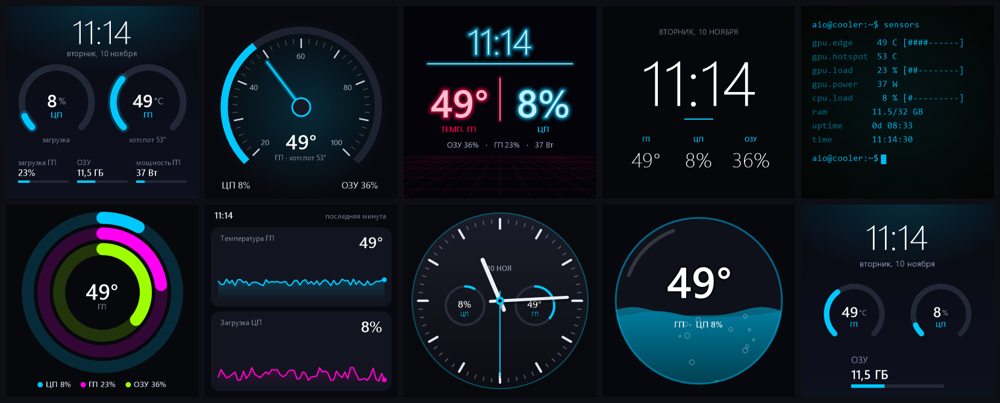
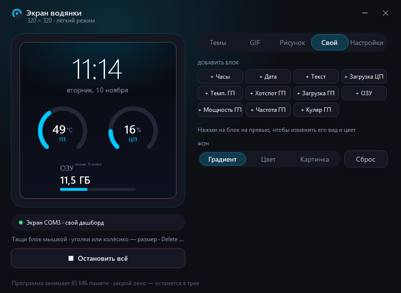
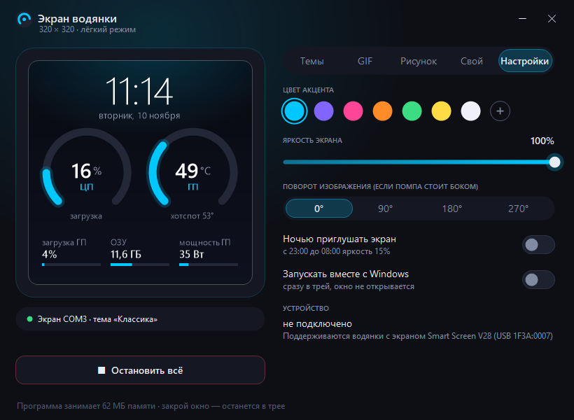

<p align="center">
  
</p>

<h1 align="center">CoolerScreen — экран водянки</h1>

<p align="center">
  Лёгкая программа для LCD-экрана на помпе жидкостного охлаждения.<br>
  Температура и загрузка ПК, 9 тем, GIF, рисунки и свой дашборд из блоков — без тяжёлого родного ПО.
</p>

<p align="center">
  
  
  
  
</p>



## Зачем это нужно

У многих водянок на помпе стоит маленький экран 320×320. Родная программа для него весит сотни мегабайт, постоянно грузит процессор и почти не настраивается. CoolerScreen делает то же самое и больше, при этом:

- весит **около 150 КБ** — один файл `.exe`, ничего не нужно устанавливать;
- в трее почти не тратит процессор (меньше 1%): кадр отправляется, только когда картинка изменилась;
- сжимает кадры встроенным в Windows кодировщиком H.264 — в 10–40 раз меньше данных, и экран не перегружается;
- работает без сторонних драйверов: датчики видеокарты AMD читаются через официальный драйвер.

## Кому это нужно

1. **Владельцам водянок с экраном на помпе**, которые работают через Smart Screen V28 (например, Jungle Leopard Astroshel и похожие модели).
2. **Тем, кого раздражает тяжёлое родное ПО**: оно занимает сотни мегабайт и грузит процессор ради одной картинки.
3. **Геймерам**, которые хотят видеть температуру и загрузку видеокарты на экране помпы, а не оверлеем поверх игры.
4. **Тем, кто украшает свою сборку**: свои GIF, картинки, рисунки и девять тем в цвет подсветки.
5. **Сборщикам ПК и моддерам**: свой дашборд из блоков, поворот изображения, если помпа стоит боком, ночное приглушение.
6. **Разработчикам**: открытый код без внешних библиотек и пример работы с USB-экраном, H.264 и датчиками Windows.

## Возможности

| Вкладка | Что умеет |
|---|---|
| **Темы** | 9 оформлений: Классика, Спидометр, Неон, Минимал, Терминал, Кольца, Графики, Часы, Жидкость (анимированная). Цифры и кольца плавно доезжают до новых значений |
| **GIF** | Любая GIF или картинка — перетащи в окно. Масштаб: заполнить / вписать / растянуть. Датчики поверх GIF |
| **Рисунок** | Рисуешь мышкой прямо на превью — сразу на экране водянки. Кисть, ластик, 3 толщины, палитра, отмена, подложка-картинка |
| **Свой** | Дашборд из блоков: часы, дата, текст, загрузка ЦП, температура и хотспот ГП, загрузка ГП, ОЗУ, мощность, частота, кулер. Блоки перетаскиваются, размер меняется уголками, колёсиком или кнопками −/+. Вид «число / кольцо / полоса», свой цвет, фон |
| **Настройки** | Цвет акцента, яркость экрана, поворот 0/90/180/270°, ночное приглушение (23:00–08:00), автозапуск с Windows |

Ещё:

- кнопка **«Остановить всё»** закрывает программы, которые мешают экрану, и полностью отпускает его;
- если экран завис, программа пытается сама вернуть его в чувство при подключении;
- после быстрых переключений программа выжидает паузу и только потом отправляет кадр, чтобы экран не захлёбывался;
- в свёрнутом виде программа работает в трее и не тормозит.



<p align="center">
  
  
</p>

## Установка

1. Скачай `CoolerScreen.exe` со страницы [Releases](../../releases/latest).
2. Закрой родную программу экрана: две программы не могут работать с одним экраном одновременно.
3. Запусти `CoolerScreen.exe`. Программа живёт в трее возле часов, двойной щелчок открывает окно.

Windows может предупредить о неизвестной программе, потому что файл не подписан. Нажми «Подробнее» → «Выполнить в любом случае».

### Сборка из исходников

Ничего ставить не нужно: компилятор C# уже есть в Windows.

```powershell
powershell -ExecutionPolicy Bypass -File build.ps1
```

Готовый файл появится в `bin\CoolerScreen.exe`.

## Совместимость

- Windows 10 / 11, 64 бита, .NET Framework 4.8 (уже есть в системе).
- Экран, который Windows видит как USB-устройство `VID_1F3A&PID_0007` (последовательный порт). Проверить можно в «Диспетчере устройств» → «Порты (COM и LPT)».
- Датчики видеокарты — для AMD Radeon (через драйвер AMD). Загрузка процессора и памяти — на любом ПК.
- Температура процессора не показывается: на Ryzen её нельзя прочитать без драйвера ядра, а такие драйверы конфликтуют с античитами.

## Важно

- Не запускай одновременно несколько программ для экрана и не переключай режимы очень быстро — дешёвые контроллеры таких экранов от этого зависают. Программа сама сглаживает переключения.
- Если экран всё-таки завис и показывает только подсветку, выключи компьютер, отключи блок питания на 30 секунд и включи снова.

## Как это устроено

Экран — контроллер Allwinner за виртуальным COM-портом. Сообщения имеют вид `5A A5 <тип> 00 | длина (4 байта, LE) | данные`:

| Тип | Назначение |
|---|---|
| `0x81` | приветствие (экран отвечает своей версией) |
| `0x90` | запрос разрешения (320×320) |
| `0x80` | яркость 0–255 |
| `0x85` | кадр: H.264 Annex-B, каждый кадр самостоятельный (SPS + PPS + IDR) |

Кадры рисуются через GDI+, переводятся в YUV 4:2:0 и сжимаются кодировщиком Media Foundation. Если он недоступен, используется запасной вариант без сжатия. Описание протокола взято из открытого проекта [astroshel-lcd](https://github.com/Duskrosy/astroshel-lcd).

## Структура

```
CoolerScreen/
├── assets/          иконка программы
├── docs/screenshots/ скриншоты для README
├── src/
│   ├── Program.cs     запуск, одна копия, мягкое закрытие (/quit)
│   ├── MainForm.cs    окно: вкладки, превью, рисовалка, конструктор
│   ├── Engine.cs      фоновый поток: кадры, темп, паузы, переподключение
│   ├── Lcd.cs         протокол экрана, оживление зависшего экрана
│   ├── MfEncoder.cs   сжатие H.264 через Media Foundation
│   ├── H264Pcm.cs     запасной кодировщик без сжатия
│   ├── Themes.cs      9 тем
│   ├── Layout.cs      блоки своего дашборда
│   ├── Render.cs      общие функции рисования, слой датчиков
│   ├── Media.cs       загрузка GIF и картинок
│   ├── Sensors.cs     ЦП, ОЗУ, видеокарта AMD
│   └── Settings.cs    настройки
├── tools/MakeIcon.cs  генератор иконки
└── build.ps1          сборка
```

Настройки, рисунок и свой дашборд хранятся в `%LOCALAPPDATA%\CoolerScreen`.

## Лицензия

[MIT](LICENSE). Программа неофициальная и не связана с производителями водянок.
